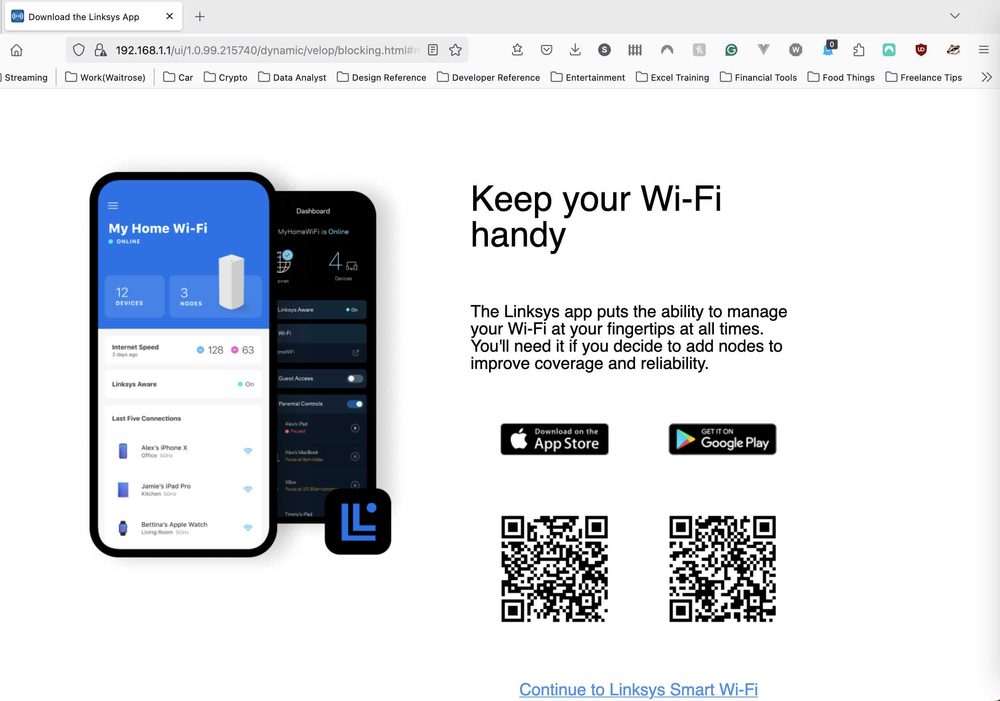

# 🧪 Linksys Velop (Community Fibre supplied hardware) – Securing Home Network

## 🧩 Overview

- **Device/Platform/Tool:** Linksys Velop
- **Category:** Network
- **OS/Version:** N/A
- **Support Context:** IT Technicians may be asked to configure a home network.

---

## 🎯 Scenario

> *Customer signed up with a new internet provider and wants to secure their home network.*

---

## 🛠️ Procedure

### Method: Configuration

1. **Step-by-step actions**
   - Customer opened a web browser and logged in to `192.168.1.1` - the admin portal for the WiFi network.
  
   - The customer was prompted to download the Linksys app to manage their connections
   - Changed the SSID and the password.
   - Setup a secondary SSID and password to be used as a guest account.

Include commands, screenshots, or diagrams where helpful.

---

## 🔍 Outcome

- **Result:** By changing the SSID and password it created a safer online experience for all household members.
- **Post-task behaviour:** Use the app to change any settings.
- **Time taken:** 20 minutes

---

## 🧠 Lessons Learned

- Navigating to a router's IP address (192.168.1.1) gives access to administrative settings for most home networks — this is essential knowledge for home or SOHO support.
- The Linksys Velop system relies heavily on its mobile app for configuration, which is different from traditional router admin panels.
- Changing the default SSID and password reduces the risk of drive-by or brute-force attacks using factory credentials.
- Setting up a guest network isolates visitor traffic from primary devices, improving network hygiene and security.
- Not all admin features are available via the web portal — some are only accessible through the app, which could limit support in headless setups.

---

## ✅ Value to Support Role

- Demonstrates familiarity with network setup and security hardening at the end-user level — a common 1st Line Support responsibility.
- Highlights ability to guide users through web and mobile app interfaces — important in consumer-facing IT roles.
- Reinforces skills relevant to CompTIA A+ (objective 2.4: Configure SOHO routers) and Security+ (objective 2.1: Secure network components).
- Builds confidence handling provider-supplied hardware — useful when users need help securing or configuring ISP equipment.

---

## 🔗 References

None
