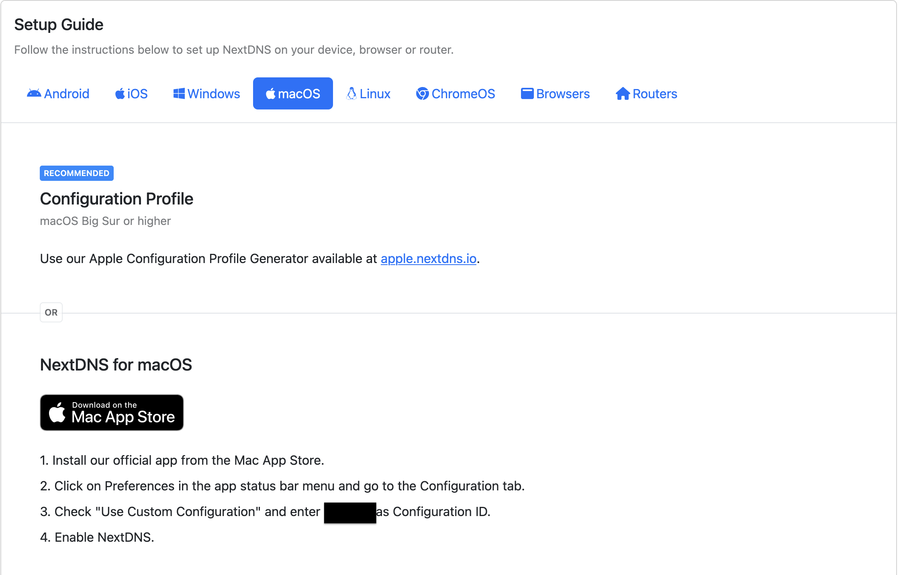
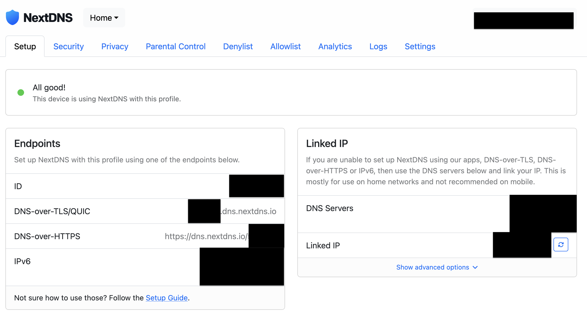

# 🧪 NextDNS – Setup DNS filtering

## 🧩 Overview

- **Device/Platform/Tool:** NextDNS
- **Category:** Networking
- **OS/Version:** macOS, iPad OS
- **Support Context:** An IT technician maybe asked to integrate similar software into a home system.

---

## 🎯 Scenario

> The customer wanted to keep his family safe while online. NextDNS came highly recommended.

---

## 🛠️ Procedure

### Method: Configuration

 **Step-by-step actions**:

- The customer navigated to `https://nextdns.io`.
- They setup a free account.
- The Free tier has a limit of 30,000 queries/month.
- The customer wasn't satisfied with that. They signed up for the Pro tier.
- Once signed up the customer setup multiple devices using the Setup Guide on the Setup tab

  

  

- Once you have a default profile you can proceed to use the built in filters.

---

## 🔍 Outcome

- **Result:** [e.g., Device reset successfully / DNS records resolved / Malware removed]
- **Post-task behaviour:** [e.g., Account login required, BIOS warning, performance improved]
- **Time taken:** [Rough estimate in minutes]

---

## 🧠 Lessons Learned

- [List at least 2–4 technical takeaways]
- [What went wrong or almost went wrong?]
- [Would you do it differently next time?]
- [Relevance to certifications or job tasks]

---

## ✅ Value to Support Role

- Reinforces [e.g., troubleshooting process, OS familiarity, data backup discipline]
- Practice in [e.g., handling customer scenarios, account recovery, endpoint configuration]
- Useful for [CompTIA A+, MD-102, Security+, real-world job tickets, etc.]

---

## 🔗 References

- [Links to official documentation or videos]
- [Your own notes or blog posts if you cross-publish]
